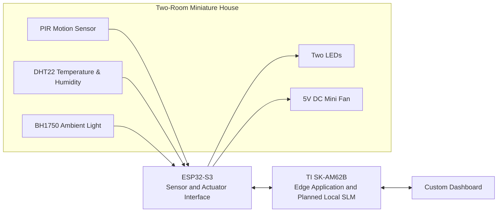

# HomePilot AI

**An offline edge-AI smart-home prototype built by Team EdgeCore for HackEdge UTiD 2026 — Track 3: Edge AI Assistant Using Small Language Models**

HomePilot AI explores how a smart-home assistant can sense and control a physical environment while keeping AI inference local. The prototype combines a TI SK-AM62B edge-computing board, an ESP32-S3 microcontroller, environmental sensors, simple actuators, a two-room miniature house, and a custom dashboard.

> [!IMPORTANT]
> This repository currently contains project documentation only. Firmware, dashboard source code, model files, wiring diagrams, pin assignments, dependency manifests, and runnable setup scripts have not yet been published here. The sections below distinguish the existing prototype from planned integrations and do not claim that the complete system can currently be reproduced from this repository.

## Project Overview

The goal of HomePilot AI is to create a privacy-conscious smart-home assistant that can:

- observe room conditions through motion, temperature, humidity, and ambient-light sensors;
- control visible and physical outputs such as lights and a miniature fan;
- present home status through a custom dashboard; and
- ultimately interpret user requests with a small language model (SLM) running on the TI SK-AM62B, without sending prompts or household data to a cloud inference service.

The physical demonstration uses a two-room miniature house to make sensor readings and automation responses easy to observe during development and testing.

## Key Features

| Capability | Description | Status |
| --- | --- | --- |
| Two-room physical prototype | A miniature house represents two independently observable smart-home spaces. | Prototype available |
| Environmental sensing | PIR, DHT22, and BH1750 devices provide motion, temperature/humidity, and ambient-light inputs. | Hardware available; full integration details not yet published |
| Physical actuation | Two LEDs represent room lighting, and a 5V DC mini fan represents climate control. | Hardware available; control implementation not yet published |
| Custom dashboard | A purpose-built interface is used to present and interact with the prototype. | Prototype available; source code not yet published |
| Edge processing | The TI SK-AM62B is the intended local compute platform, with the ESP32-S3 handling sensor and actuator interfacing. | Architecture defined; integration details not yet published |
| Local language assistant | A small language model is intended to translate natural-language requests into smart-home actions locally. | Planned integration |
| Cloud-independent inference | The target design avoids cloud inference to improve privacy, latency, and resilience to internet outages. | Project goal |

## Hardware Components

| Component | Role in the prototype |
| --- | --- |
| TI SK-AM62B | Edge-computing platform intended to host local application logic, the dashboard backend, and the small language model. |
| ESP32-S3 | Microcontroller intended to collect sensor readings and control the physical outputs. |
| PIR motion sensor | Detects motion or occupancy events in the miniature home. |
| DHT22 sensor | Measures temperature and relative humidity. |
| BH1750 sensor | Measures ambient-light intensity. |
| Two LEDs | Represent controllable lighting in the two-room model. |
| 5V DC mini fan | Represents a controllable cooling or ventilation device. |
| Two-room miniature house | Provides the physical smart-home environment for the demonstration. |

Power-switching circuitry, exact wiring, GPIO assignments, and electrical protection requirements are not yet documented in this repository. Do not connect the fan directly to a GPIO pin; follow the hardware datasheets and use an appropriate driver circuit when the electrical design is published.

## System Architecture

The planned division of responsibilities is shown below. The exact communication protocol between the ESP32-S3, TI board, and dashboard has not yet been published.

At a high level:

1. Sensors in the miniature house observe motion, temperature, humidity, and light levels.
2. The ESP32-S3 serves as the hardware-facing controller for collecting readings and driving the two LEDs and fan.
3. The TI SK-AM62B is the intended edge host for higher-level orchestration and local language-model inference.
4. The dashboard provides a human-readable view of the home and a control surface for the prototype.
5. In the planned AI workflow, a locally hosted SLM will interpret a user request, map it to a supported home action, and pass the action through the control layer—without cloud inference.

## Two-Room Smart-Home Prototype

The miniature house gives the team a tangible environment in which to demonstrate sensing and actuation. Its two LEDs represent room lights, while the mini fan represents a household cooling or ventilation load. The PIR, DHT22, and BH1750 provide three complementary views of the environment: occupancy, climate, and illumination.

The exact placement of each sensor and actuator, room-to-device mapping, automation thresholds, and wiring layout have not yet been published. These details will be added with the hardware documentation so that the prototype can be reproduced safely.

## Dashboard

HomePilot AI includes a custom dashboard for the physical prototype. It is intended to bring together sensor data, device state, and user controls in one interface.

The dashboard source, screenshots, supported controls, backend interface, and launch command are not yet present in this repository. Until those files are published, the dashboard should be treated as part of the team prototype rather than a reproducible repository component.

## Technologies

| Area | Technology |
| --- | --- |
| Edge computing | TI SK-AM62B |
| Embedded control | ESP32-S3 |
| Motion sensing | PIR motion sensor |
| Climate sensing | DHT22 temperature and humidity sensor |
| Light sensing | BH1750 ambient-light sensor |
| Actuation | Two LEDs and a 5V DC mini fan |
| User interface | Custom dashboard |
| AI | Small language model for planned on-device inference |

Programming languages, frameworks, model/runtime choices, communication protocols, and software dependencies will be documented after their implementations are added to the repository.

## Installation and Setup

The repository is not yet installable because it does not contain the firmware, dashboard application, model artifacts, dependency files, pin map, or wiring guide required to reproduce the system.

When those assets are published, setup documentation will cover:

1. Preparing the TI SK-AM62B software environment.
2. Wiring and flashing the ESP32-S3 safely.
3. Connecting and validating the PIR, DHT22, and BH1750 sensors.
4. Connecting the LEDs and the fan through suitable current-limiting and driver circuitry.
5. Configuring communication between the ESP32-S3 and TI board.
6. Installing and starting the dashboard.
7. Installing the selected local SLM and inference runtime.
8. Verifying end-to-end sensing, control, and local inference.

No commands are provided yet because the necessary implementation files and dependencies are not in the repository. This avoids presenting unverified setup instructions.

## How to Run the Project

There is currently no reproducible run command in this repository. After the implementation is published, this section will contain the exact commands for:

- starting the ESP32-S3 firmware;
- launching the TI SK-AM62B edge service;
- starting the dashboard;
- loading the local language model; and
- running an end-to-end hardware check.

## Development Status

HomePilot AI is an active HackEdge UTiD 2026 prototype.

### Available now

- Project concept and edge-first architecture
- Two-room physical miniature house
- Selected TI SK-AM62B and ESP32-S3 platforms
- PIR, DHT22, and BH1750 sensor hardware
- Two LEDs and a 5V DC mini fan
- Custom prototype dashboard
- Project documentation in this README

### In progress or planned

- Publishing firmware and dashboard source code
- Publishing wiring diagrams, pin assignments, and electrical details
- Documenting the board-to-board communication interface
- Integrating and evaluating a small language model on the TI SK-AM62B
- Connecting natural-language intents to a constrained set of device actions
- Adding reproducible installation, launch, validation, and test instructions

No performance, accuracy, latency, power-consumption, or test-results claims are made at this stage.

## Team EdgeCore

| Team member |
| --- |
| Mujtaba Altameemi |
| Hazel White |
| Bahar Ozer |
| Daniel Guadiana |

Developed for **HackEdge UTiD 2026 — Track 3: Edge AI Assistant Using Small Language Models**.
